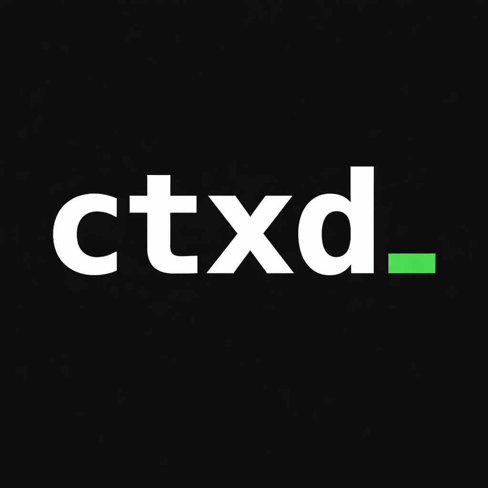

# ctxd

  

Local context infrastructure for AI agents.

## Overview

ctxd tracks folders selected on your computer and exposes them through ctxfs as
path-oriented, agent-readable context.

The user documentation in [`docs/public`](docs/public/README.md) is the source of
truth for [ctxd.dev/docs](https://ctxd.dev/docs/overview/):

- [Overview](docs/public/overview.md)
- [Quickstart](docs/public/quickstart.md)
- [Local tracker](docs/public/local-tracker.md)
- [ctxfs](docs/public/ctxfs.md)
- [CLI](docs/public/cli.md)
- [Local API](docs/public/api.md)
- [Security](docs/public/security.md)

Edit the canonical page instead of duplicating setup or reference instructions in
this README.

## Contributing

See [CONTRIBUTING.md](CONTRIBUTING.md) for the package version bump and release
process.
